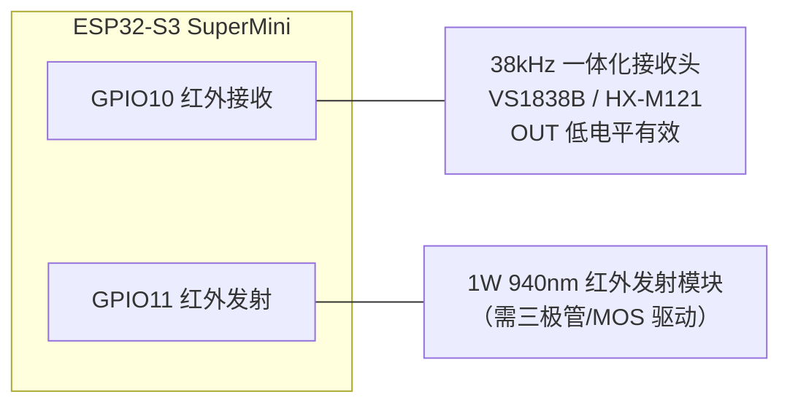
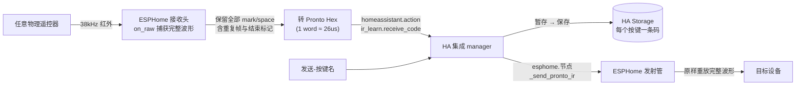
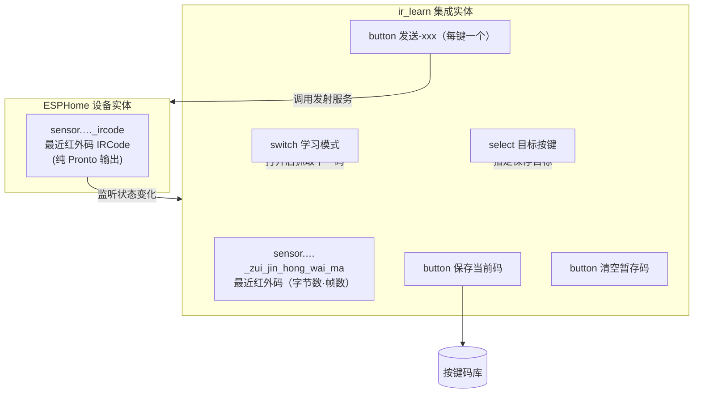

# ESP32-S3 通用红外学习桥

一个 ESPHome + Home Assistant 组合项目：ESP32-S3 SuperMini 作为**通用红外收发桥**，配套 HA 自定义集成 `ir_learn` 实现遥控器按键的学习、保存与一键发射。

**核心特性：红外学习不依赖协议识别，任何遥控器直接学、直接发。** 无论是 NEC、Space 编码（投影/空调）还是戴森类私有协议，都按原始波形逐 word 记录并原样重放，无需为新设备写规则。

---

## 目录结构

```text
.
├── zhcgs-ota-bridge-ir.yaml      # ESPHome 完整配置（红外 + 其他板载传感器）
├── esphome_ir_config.yaml        # 精简版红外配置参考
└── custom_components/
    └── ir_learn/                 # Home Assistant 自定义集成
        ├── __init__.py
        ├── manifest.json
        ├── config_flow.py        # 配置 / 选项流程
        ├── const.py
        ├── entity.py
        ├── manager.py            # 核心：码解析、去重、学习、发射调度
        ├── services.py / services.yaml
        ├── switch.py             # 学习模式开关
        ├── select.py             # 目标按键选择
        ├── button.py             # 保存 / 清空 / 每个按键的发射按钮
        ├── sensor.py             # 「最近红外码」状态与属性
        ├── strings.json / translations/
        └── icon.png
```

---

## 硬件接线

主控：**ESP32-S3 SuperMini**（4MB Flash，ESP-IDF 框架）。红外部分只需要两个引脚。

### 接线示意



### 引脚表

| 引脚 | 功能 | 外设 | 说明 |
|---|---|---|---|
| GPIO10 | 红外接收 | 38kHz 一体化接收头 | `inverted: true`（输出低电平有效） |
| GPIO11 | 红外发射 | 1W 940nm 发射模块 | GPIO 只提供逻辑电平，模块须自带驱动 |

> 接收头若用 5V 供电，OUT 需分压到 3.3V 再接 GPIO10。发射模块功率大，建议独立供电。

---

## 系统架构

### 学习与发射数据流



### 实体关系



> **注意区分两个「最近红外码」实体**：`sensor.*_ircode` 是 ESPHome 生成的原始码输出；`sensor.hong_wai_xue_xi_an_jian_zui_jin_hong_wai_ma` 是插件生成的统计/交互实体。插件配置里的「红外码文本传感器」要填前者。

---

## 通用红外方案原理

红外接收头输出的本质是**高低电平持续时间序列**。不同协议只是对这段序列的不同结构化解释：

- **NEC / JVC / LG**：标准协议，ESPHome 可直接解码；
- **Space 编码**（投影、部分空调）：引导头 + 数据位宽度区分 0/1，帧尾有长静默；
- **私有协议**（戴森风扇等）：帧结构各异，结束标记也不同。

传统做法是"识别协议 → 存结构化数据 → 重新编码发射"，但每来一个新设备就要写规则。本项目采用**波形级通用方案**：

1. **学习**：`on_raw` 捕获完整波形，**一个 word 都不删**——保留所有重复帧、引导脉冲、结尾长静默；
2. **存储**：整段波形转成 Pronto Hex（38kHz，1 word ≈ 26us）保存；
3. **发射**：把保存的完整 Pronto 原样发一次，设备收到的和物理遥控器按一次完全一致。

因此不需要知道设备用的是什么协议，也不需要为它设定重复次数或结束标记。

```text
物理按键 ──[完整 N 帧波形]──> 接收 ──[N 帧全存]──> Pronto ──[原样发 N 帧]──> 设备
                                  ↑ 不截断              ↑ 不重编码
```

> 仅有一条通用过滤：少于 20 个 word 的片段视为杂讯/自收自发碎片丢弃，与设备类型无关。

---

## 安装

### 1. ESPHome 端

1. 把 `zhcgs-ota-bridge-ir.yaml` 中的 `remote_receiver` / `remote_transmitter` / `api.actions` / `homeassistant.action` 相关段合并到你的设备配置；
2. 按实际硬件修改 GPIO（见 GPIO 分配表）；
3. 在 `secrets.yaml` 中配置 `wifi_ssid`、`wifi_password`、`ota_password`、`fallback_wifi_password`；
4. 编译并 OTA 烧录。

### 精简示例：ESP32-S3 SuperMini + 1W 940nm 发射模块

下面是一份**可直接复制使用**的最小配置，只含红外收发，不含其他传感器。它来自本项目最终验证通过的通用方案。

接线：

| 模块 | 模块引脚 | 接 ESP32-S3 | 备注 |
|---|---|---|---|
| 38kHz 一体化接收头（VS1838B / HX-M121） | VCC / GND / OUT | 3.3V / GND / GPIO10 | 输出低电平有效，故 `inverted: true`；若模块用 5V 供电，OUT 需分压到 3.3V |
| 1W 940nm 红外发射模块 | VCC / GND / IN | 5V（按模块规格）/ GND / GPIO11 | **必须带三极管/MOS 驱动**，GPIO 不可直驱发射管；大功率建议独立供电 |

```yaml
# ============ ESP32-S3 SuperMini 通用红外收发（最小配置）============
esphome:
  name: ir-bridge-s3            # HA 服务前缀：esphome.ir_bridge_s3_*
  friendly_name: "红外桥 ESP32-S3"

esp32:
  board: esp32-s3-devkitc-1
  variant: esp32s3
  framework:
    type: esp-idf               # homeassistant.action 等新特性需较新版本

logger:

wifi:
  ssid: !secret wifi_ssid
  password: !secret wifi_password

ota:
  - platform: esphome
    password: !secret ota_password

# 暂存学习到的完整波形与统计信息
globals:
  - id: ir_pronto_out
    type: std::string
    initial_value: '""'
  - id: ir_repeat_count
    type: int
    initial_value: '1'
  - id: ir_pulse_count
    type: int
    initial_value: '0'

api:
  encryption:
    key: !secret api_encryption_key   # 用 secrets.yaml 保存，别写进公开文件
  actions:
    # HA 集成调用：发送一段 Pronto 完整波形
    - action: send_pronto_ir
      variables:
        code_str: string
        repeats: int          # 保留参数以兼容调用方；波形已含全部帧，不再重复发射
      then:
        - remote_transmitter.transmit_pronto:
            transmitter_id: remote_tx
            data: !lambda 'return code_str;'

# ---------- 红外接收 ----------
remote_receiver:
  pin:
    number: GPIO10
    inverted: true            # 38kHz 接收头输出低电平有效
  dump: all                   # 打印解码日志，方便调试
  idle: 25ms                  # 必须大于常见帧间隔（约 7ms），否则完整码被拆成碎片
  on_raw:
    - lambda: |-
        if (x.size() < 4) return;
        std::vector<int32_t> vals = x;
        if (vals.size() < 20) return;    // 过滤引导头碎片/自收自发（通用规则，与设备无关）
        int frames = 1;                  // 仅用于显示，不参与发射
        for (size_t i = 1; i + 1 < vals.size(); i++) {
          if (vals[i] < -5000 && vals[i + 1] > 1500 && vals[i + 1] < 6000) frames++;
        }
        id(ir_repeat_count) = frames;
        // 完整波形逐 word 转 Pronto，不删结尾静默、不截断重复帧
        char buf[16];
        std::string out = "0000 006D";   // 38kHz 频率字
        size_t count = 0;
        for (size_t i = 0; i < vals.size(); i++) {
          int32_t a = vals[i] < 0 ? -vals[i] : vals[i];
          int w = (int)(a / 26.0 + 0.5);  // 1 word ≈ 26us
          if (w < 1) w = 1;
          snprintf(buf, sizeof(buf), "%04X", (unsigned int)w);
          out += " ";
          out += buf;
          count++;
        }
        if (count % 2) { out.erase(out.size() - 5); count--; }  // word 数必须为偶数
        char hdr[16];
        snprintf(hdr, sizeof(hdr), " %04X 0000", (unsigned int)(count / 2));
        out.insert(9, hdr);
        id(ir_pronto_out) = out;
        id(ir_pulse_count) = (int)count * 2;
        ESP_LOGI("ir_rx", "字节数=%d 帧数=%d", id(ir_pulse_count), frames);
        id(last_ir_code).publish_state(out);
    # 完整码直接推给 HA 集成，绕过 text_sensor 的 255 字符上限
    - homeassistant.action:
        action: ir_learn.receive_code
        data:
          code: !lambda 'return "pronto:" + id(ir_pronto_out);'
          repeats: !lambda 'return std::to_string(id(ir_repeat_count));'
          pulses: !lambda 'return std::to_string(id(ir_pulse_count));'

# ---------- 红外发射 ----------
# 1W 940nm 发射模块请务必使用带驱动的模块；GPIO 只提供逻辑电平
remote_transmitter:
  id: remote_tx
  pin: GPIO11
  carrier_duty_percent: 50%

# HA 集成监听此实体显示最近收到的码（长码会被 HA 截断，仅供显示）
text_sensor:
  - platform: template
    id: last_ir_code
    name: "最近红外码 IRCode"
```

说明：

- `repeats` 参数在 `send_pronto_ir` 中保留只是为了兼容调用方，实际不再用它重复发射——完整波形已经包含了所有重复帧；
- 若还需要发射旧的 NEC / raw 格式按键，可另外补充 `send_nec_ir` / `send_raw_ir` action（见完整配置 `zhcgs-ota-bridge-ir.yaml`）；
- `secrets.yaml` 需包含 `wifi_ssid`、`wifi_password`、`ota_password`、`api_encryption_key`（可用 `esphome gen-key` 生成）。

### 2. Home Assistant 端（插件安装）

**方式 A：手动安装**

1. 把仓库里的 `custom_components/ir_learn/` 整个目录复制到 HA 配置目录下的 `custom_components/`（最终路径应为 `<HA配置目录>/custom_components/ir_learn/`，内含 `manifest.json`）；
2. 重启 Home Assistant；
3. 进入「设置 → 设备与服务 → 添加集成」，搜索「红外学习按键 IR Learn」。

**方式 B：HACS 自定义仓库**

1. HACS → 集成 → 右上角菜单 → 自定义仓库；
2. 填入本仓库地址，类别选「Integration」；
3. 在 HACS 中安装「IR Learn」，重启 HA，再按上面第 3 步添加集成。

添加集成时需填写三个参数：

| 参数 | 示例 | 说明 |
|---|---|---|
| ESPHome 节点名称 | `zhcgs_ota_bridge` | 设备 `esphome:` 下的 `name`（下划线形式），决定发射服务 `esphome.<节点名>_send_pronto_ir` |
| 红外码文本传感器 | `sensor.zhcgs_ota_bridge_zuijin_hongwai_ma_ircode` | ESPHome 生成的「最近红外码 IRCode」实体，**是 `sensor.` 域**，可在「开发者工具 → 状态」里搜 `ircode` 找到准确 ID |
| 遥控协议 | `pronto` | 兜底默认值；波形方案下 learn 到的码都带 `pronto:` 前缀，此项一般不影响 |

> 节点名填错会导致点发射时提示「找不到服务」；传感器实体填错会导致学习时一直显示「等待按键…」。这两处是安装后最常见的问题。

安装完成后，集成会创建一个设备，下面挂 6 类实体（见下表）。

---

## 插件使用指南

### 界面实体

在「设置 → 设备与服务 → 红外学习按键」设备页可以看到：

| 实体 | 类型 | 作用 |
|---|---|---|
| 最近红外码 | Sensor | 学习反馈：state 显示 `字节N · M帧`；属性里有完整码、暂存码、目标按键、每个按键的字节/帧数 |
| 学习模式 | Switch | 打开后抓取下一个完整红外码到暂存区 |
| 目标按键 | Select | 选择本次学习要保存到哪个按键 |
| 保存当前码到目标按键 | Button | 把暂存码写入选中的按键 |
| 清空暂存码 | Button | 丢弃当前暂存码 |
| 发送-\<按键名\> | Button | 每个已保存按键对应一个，点击即发射 |

### 学习一个新按键（完整流程）

1. **新建按键**：集成选项 →「批量添加按键」→ 每行输入一个名称（如「投影开关」，也可用逗号分隔），可一次建多个；第一个按键自动成为「目标按键」。
   - 已存在的按键不用重复新建，直接用「目标按键」下拉框选中它即可。
2. **开学习**：打开「学习模式」开关。
3. **按遥控**：遥控器对准接收头按一下。成功时：
   - 「最近红外码」state 变成 `字节132 · 5帧` 之类的数值；
   - 「学习模式」开关**自动关闭**（这是学习成功的标志）。
4. **核对**：看 state 的字节数是否正常（风扇约 72、投影约 132）。若显示 `字节4 · 1帧`，说明只抓到引导头碎片，**重按一次**即可。
5. **保存**：点「保存当前码到目标按键」。
6. **发射**：点生成的「发送-投影开关」按钮，目标设备应响应。

> 学习不成功时先看 ESPHome 日志是否打印 `字节数=... 帧数=...`；有这行说明接收正常，问题在 HA 侧配置。

### 重新学习 / 修改某个按键

1. 用「目标按键」下拉框选中要改的按键；
2. 打开「学习模式」，按遥控器新码；
3. 点「保存当前码到目标按键」覆盖旧码。

### 删除按键

集成选项 →「批量删除按键」→ 可多选要删除的按键。确认后对应的「发送-xxx」实体会从集成中直接消失（不只是变成不可用）。

### 手动录入现成 Pronto 码

若已有别人分享的 Pronto Hex，可跳过接收：

1. 把集成选项里的「遥控协议」设为 `pronto`；
2. 在 HA 中调用服务 `ir_learn.receive_code`，`code` 填 `pronto:0000 006D ...`；
3. 按正常流程「保存」即可。

### 在自动化 / 脚本里调用

发射某个按键：

```yaml
action: ir_learn.send_button
data:
  name: 投影开关
```

用按钮实体也行：

```yaml
action: button.press
target:
  entity_id: button.hong_wai_xue_xi_an_jian_fa_song_tou_ying_kai_guan
```

一次添加多个按键（删除时把 `add_button` 换成 `delete_button` 即可）：

```yaml
action: ir_learn.add_button
data:
  names:
    - 电视-电源
    - 电视-音量+
```

### 服务参考

| 服务 | 参数 | 说明 |
|---|---|---|
| `ir_learn.add_button` | `name` 或 `names` | 新建空按键并设为目标，支持一次多个 |
| `ir_learn.delete_button` | `name` 或 `names` | 删除按键（支持一次多个，实体同步移除） |
| `ir_learn.send_button` | `name` | 按名称发射 |
| `ir_learn.clear_buffer` | — | 清空暂存码 |
| `ir_learn.receive_code` | `code`, `repeats?`, `pulses?` | 把码推入集成（ESPHome 内部自动调用，也可手动录入） |

所有服务都可选传 `config_entry_id`，用于存在多个集成实例时指定目标。

---

## 调试实录：踩过的坑与解法

本项目调试过程中遇到多个典型问题，记录如下，供二次开发参考。

### 1. 学习模式开关「跳不掉」

**现象**：打开学习模式后按遥控器，码进来了但开关一直不关。

**根因**：改了桌面上的 Python 文件却**没有同步到 HA 容器**，HA 一直跑旧代码；旧版本里学习路径还被临时禁用过。

**解法**：建立「改完 → scp → docker cp → 重启 HA → 用 md5 核对」的部署流程，确认运行的是新代码。

### 2. 风扇关机要按两次

**现象**：开机一次成功，关机要按两次。

**根因**：早期方案只发单帧，该设备需要多帧确认。

**过程**：先试固定 `repeat: times: 2`，后改为按接收帧数动态 repeat。

### 3. 风量 +/− 按一下跳好几档

**现象**：风量键一次连跳数档。

**根因**：动态 repeat 被自收自发干扰数到 8 帧。**累加型按键每帧都是一次独立动作**，发 9 帧就跳 9 档。

**过程**：一度把 repeat 上限压到 2 来缓解。

### 4. 投影仪学不会（碎片覆盖）

**现象**：学习时「最近红外码」在 `字节4 · 1帧` 和 `字节132 · 1帧` 之间乱跳。

**根因**：投影引导头（5.7ms 高 + 2.9ms 低）被接收头单独切成一次 `on_raw`，产生 1~2 对碎片，**在完整码之后到达并覆盖**了它。

**解法**：加通用过滤——少于 20 word 的片段直接丢弃，不显示也不触发学习。

### 5. 投影 / 戴森学出来发射无反应（结束标记被删）

**现象**：学到的码能存能发，设备不响应；把物理遥控器的原始码手工写进去就能响应。

**根因**：ESPHome 接收 lambda 的 `pop_back()` 删掉了结尾长静默，奇数修正又删掉结束脉冲，而投影的 `0013 03C2`、戴森的 `001B 0181` 都是**协议必需的结束标记**。

**过程**：先按引导宽度硬编码补标记（投影补 `0013 03C2`、戴森补 `001B 0181`），虽能工作但每来一个设备就要加规则。

### 6. 最终方案：全波形保留

**问题**：上述补丁属于"按设备设规则"，不可持续。

**解法**：不再删任何 word——保留全部重复帧和结束标记，发射时原样重放。删掉 HA 侧所有补标记的硬编码逻辑。**这是本项目最终采用的通用方案**，新遥控器开箱即学。

### 7. 其他工程细节

- **HA 服务 schema 拒绝 `repeats`**：`homeassistant.action` 的 `data` 必须是字符串，传 int 会被静默拒绝；改用 `std::to_string()`。
- **HA state 255 字符上限**：完整码可能数千字符，放不进 state；改为通过 `homeassistant.action` 直接推送给集成，text_sensor 仅显示（截断无妨）。
- **Pronto 不是线上协议**：它只是波形记法，ESPhome 解码器永远`识别`不出 Pronto，不要指望 `on_pronto` 学习。
- **ESP-IDF 下载超时**：国内网络连 GitHub 下载框架易超时，可用 `ghfast.top` / `ghproxy.net` 镜像手动下载解压到 ESPHome 缓存目录。

---

## 常见问题

**收不到码 / 状态一直「等待按键…」**
检查 ESPHome 日志是否打印 `字节数=... 帧数=...`；确认接收头 `inverted: true`；确认集成里填的传感器实体 ID 与 ESPHome 生成的完全一致（是 `sensor.` 域）。

**学到的是 `字节4 · 1帧`**
抓到引导头碎片，重按一次；若持续出现，检查 `idle: 25ms` 是否小于设备帧间隔。

**发射无反应但物理遥控能用**
确认固件是通用版（保留完整波形），且按键是用新固件重新学习的；旧码可能是被截断的残缺码，需重学。

**点击发送提示找不到服务**
确认节点名正确，设备端已注册 `send_pronto_ir` action；旧版 ESPHome 用 `api.services` 而非 `api.actions`。

---


## 许可

MIT License，可自由修改和分发。
